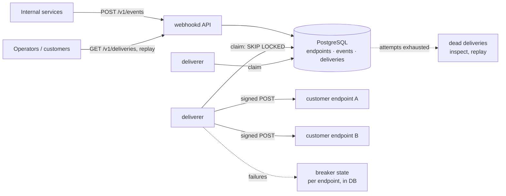
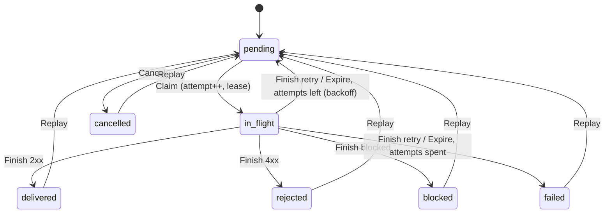
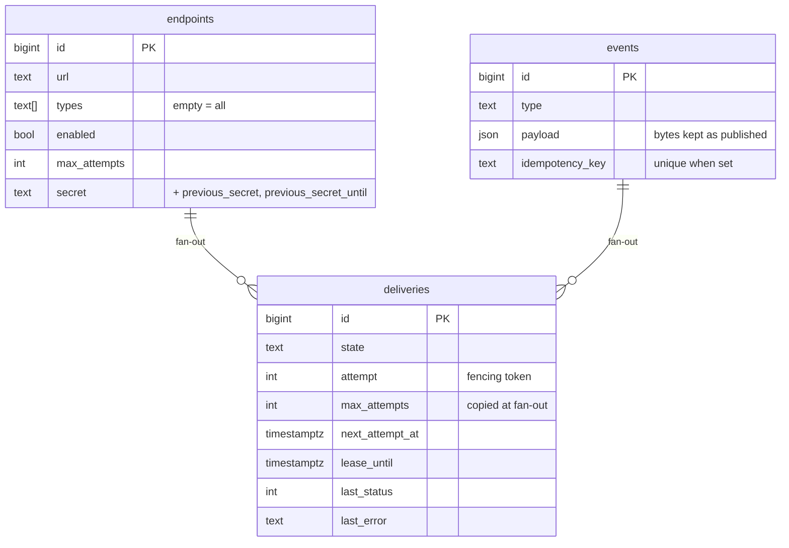

# go-webhook-gateway

[](https://github.com/Nguyenngoctruong274/go-webhook-gateway/actions/workflows/ci.yml)


[](LICENSE)

A webhook delivery gateway in Go. Internal services publish events once;
the gateway fans them out to every subscribed customer endpoint, signs
each request with HMAC, retries with backoff when the receiver fails,
stops hammering an endpoint that is down, refuses to call addresses it
should not, and keeps the delivery history so customers can see what
happened and replay it.

> 🚧 Built in public as a 10-day series. See the [roadmap](#roadmap) for progress.

## Why

Sending an HTTP POST is easy. Sending it reliably to a thousand customers'
servers, some of which are slow, broken, or hostile, is where the work is.
This project answers those questions with code and tests:

- **Authenticity.** Every request carries an HMAC-SHA256 signature over a
  timestamp and the body, so a receiver can reject forgeries and replays.
  Secrets rotate without a window where deliveries fail.
- **At-least-once, with a stable id.** A delivery may be retried; each
  carries an id the receiver can use to deduplicate.
- **Retries that respect the receiver.** 2xx is done, most 4xx are the
  receiver's final answer, 5xx and timeouts retry with exponential backoff
  and jitter, and after the last attempt the delivery is dead for an
  operator to replay.
- **Circuit breaker per endpoint.** An endpoint that keeps failing is
  skipped for a while rather than retried by every delivery at once; the
  state is shared by all gateway instances.
- **SSRF-safe.** Customer-supplied URLs cannot reach loopback, private or
  link-local addresses, including through DNS rebinding or redirects.
- **Visible.** Delivery history with response snippets, per-endpoint
  success rates and latency, Prometheus metrics and alerts.

## Architecture



The diagram is the target design; the [roadmap](#roadmap) shows what is
built so far.

| Package | Responsibility |
|---|---|
| `cmd/webhookd` | Service wiring, graceful shutdown |
| `cmd/webhook-receiver` | Reference receiver: verifies signatures, ignores duplicate deliveries, asks for retries on failure |
| `internal/config` | Environment configuration with validation |
| `internal/httpapi` | Probes now; endpoints, events and deliveries later |
| `internal/event` | Domain: events, endpoints, deliveries; outcome classification; delivery state machine with fenced attempts; retry backoff with jitter (no I/O) |
| `internal/signing` | HMAC-SHA256 signing headers, verification with constant-time compare and timestamp tolerance, secret rotation with overlap |
| `internal/postgres` | Connection pool, embedded migrations, store: endpoints with secret rotation, events fanned out to deliveries with idempotency keys, deliveries claimed with `SKIP LOCKED` and finished under a fencing token |
| `internal/deliverer` | Sender: one signed POST per attempt with timeouts, bounded response reads, no redirects; Pool: bounded concurrency, heartbeats, drain |
| `internal/reaper` | Timer loop that returns silent deliverers' deliveries to the queue |
| `internal/breaker` | Per-endpoint circuit breaker: closed / open / half-open as a pure value; the store keeps one per endpoint so every instance sees the same breaker |
| `internal/egress` | SSRF guard: resolves a receiver's host, refuses private, loopback, link-local and other reserved addresses, and connects to the address it checked |
| `internal/testdb` | Isolated PostgreSQL schema per test |

## Quick start

```bash
make up          # PostgreSQL in Docker (databases webhooks and webhooks_test)
make run         # webhookd on :8080
curl localhost:8080/healthz   # {"status":"ok"}
curl localhost:8080/readyz    # {"status":"ready"}; 503 if PostgreSQL is down
make test-db     # unit tests + tests against the real PostgreSQL
```

webhookd applies pending migrations at startup, under an advisory lock so
that several instances starting together migrate once.

Or run everything in containers: `make stack`.

## Configuration

| Variable | Default | Description |
|---|---|---|
| `WH_DATABASE_URL` | required | `postgres://` or `postgresql://` URL of the database |
| `WH_DB_MAX_CONNS` | `20` | Maximum open database connections (API and deliverers share them) |
| `WH_HTTP_ADDR` | `:8080` | Listen address |
| `WH_LOG_LEVEL` | `info` | `debug`, `info`, `warn`, `error` |
| `WH_SHUTDOWN_TIMEOUT` | `15s` | Maximum time to finish in-flight requests |
| `WH_SHUTDOWN_DRAIN` | `0` | Time `/readyz` reports 503 before the listener closes |
| `WH_DELIVER_CONCURRENCY` | `16` | Requests in flight at once on this instance, `0` to `1000`; `0` runs no deliverers |
| `WH_DELIVER_TIMEOUT` | `10s` | End-to-end timeout of one request to a receiver (at least `1s`) |
| `WH_DELIVER_LEASE` | `60s` | Lease on a claimed delivery; must exceed the timeout; heartbeats renew it every third |
| `WH_DELIVER_DRAIN` | `15s` | On shutdown, how long in-flight requests may finish before they are cancelled |
| `WH_REAP_INTERVAL` | `5s` | How often expired leases are swept (at least `100ms`) |
| `WH_BREAKER_FAILURES` | `5` | Consecutive transient failures that open an endpoint's circuit breaker |
| `WH_BREAKER_OPEN_FOR` | `30s` | First open period; it doubles after each failed probe |
| `WH_BREAKER_MAX_OPEN_FOR` | `15m` | Cap on the open period |
| `WH_BREAKER_PROBE_TIMEOUT` | `2m` | How long a half-open probe may stay silent before another is sent; must exceed `WH_DELIVER_TIMEOUT` |
| `WH_EGRESS_ALLOW` | *(empty)* | Comma-separated CIDRs deliveries may reach although they are private or reserved (receivers in the same VPC; `127.0.0.0/8` in development). Keep empty in production |
| `WH_EGRESS_PORTS` | *(any)* | Comma-separated ports receivers may listen on, e.g. `443,8443` |

Invalid configuration is reported all at once at startup, without echoing
the database URL (it holds a password).

## Probes and shutdown

- `GET /healthz`: liveness. Does **not** touch PostgreSQL, so a database
  blip does not restart every pod.
- `GET /readyz`: readiness. Returns 503 while draining or while PostgreSQL
  does not answer a ping.
- On `SIGTERM`: readiness turns 503, the service waits `WH_SHUTDOWN_DRAIN`,
  then shuts the HTTP server down within `WH_SHUTDOWN_TIMEOUT`.

## Domain

`internal/event` holds the rules and no I/O; the store and the deliverer
apply them, and the tests here are the reference.

**Events and endpoints.** A producer publishes `Spec{Type, Payload,
IdempotencyKey}`: the type is `order.paid`-style, the payload a JSON
object or array up to 256 KiB. A customer registers `EndpointSpec{URL,
Types, MaxAttempts}`: absolute http(s), no credentials or fragment,
subscribed to listed types or to all. Whether the URL's host may be
contacted at all is decided at delivery time against the resolved
address (day 7), because DNS can change after registration.

**Outcome of an attempt.**

| Receiver's answer | Outcome | Then |
|---|---|---|
| 2xx | `Delivered` | done |
| 5xx, 408, 429, timeout, connection error | `Retry` | next attempt after the backoff; `failed` once attempts are spent |
| any other 4xx, 3xx (redirects are not followed) | `Rejected` | done: repeating the same request would get the same answer |
| gateway refused to send (forbidden address) | `Blocked` | done: the endpoint needs fixing |

**Delivery lifecycle.** One event × one subscribed endpoint = one
delivery, with the endpoint's `MaxAttempts` copied in at fan-out time.



The attempt number is a fencing token: `Claim` returns it, and `Finish`
and `Heartbeat` must present it. A deliverer that stalled past its lease
and reports after the reaper handed the delivery on is refused with
`ErrLeaseLost`; the attempt that replaced it is untouched. Every refused
transition leaves the delivery exactly as it was.

**Retry backoff.** `Backoff{Base, Max, JitterPercent}`: the ceiling
doubles per failed attempt from 5s, capped at 1h, and half of it is
random by default, so a receiver recovering from an outage is not hit by
every pending delivery at once. With the default 8 attempts the last
retry comes about 21 minutes after the first failure.

`FuzzDeliveryInvariants` drives a delivery through random sequences of
claim, finish (every outcome), stale-token finish, expire, cancel, replay
and heartbeat, with time moving, and checks that the attempt counter
stays within bounds, a lease exists exactly while in flight, a pending
delivery always has attempts left, a refused operation changes nothing,
and a stale token is never accepted. CI fuzzes for 20s on every push.

## Signing

Every delivery carries three headers:

```http
POST /webhook HTTP/1.1
Webhook-Id: 1042
Webhook-Timestamp: 1793786400
Webhook-Signature: v1=67c9e8d3…aefef7da[, v1=<signature under the previous secret>]
Content-Type: application/json

{"type":"order.paid","data":{"id":42}}
```

The signature is `hex(HMAC-SHA256(secret, "<timestamp>.<body>"))`. A
receiver in any language verifies it in four steps, which is what
`signing.Verifier` and the reference receiver do:

1. Read the raw body **before** parsing it; the signature is over the
   bytes on the wire.
2. Refuse timestamps more than 5 minutes from the receiver's clock. This
   runs before any HMAC, so the verifier is not a signing oracle for
   stale inputs, and it is what stops replays of captured requests:
   the timestamp is inside the MAC, so it cannot be moved.
3. Compute the HMAC for each secret the receiver holds and compare it in
   constant time with each `v1=` value in the header. Unknown schemes are
   skipped, so the gateway can add a `v2` later without breaking anyone.
4. Use `Webhook-Id` to ignore a delivery already processed: the gateway
   retries when a response is lost, so a receiver that is not idempotent
   will act twice.

```bash
# The same thing with openssl, to check an implementation:
printf '%s.%s' "$TS" "$BODY" | openssl dgst -sha256 -hmac "$SECRET"
```

**Secret rotation.** `Rotation.Rotate(next, now, overlap)` makes the new
secret current and keeps the old one active for `overlap`. During that
window the gateway signs every request with both, so a receiver that
still holds the old secret keeps verifying; after it, only the new one
signs. At most two secrets are ever active, so a receiver never needs to
accept more than two. Secrets are `whsec_` + 32 random bytes in hex, and
anything shorter than 16 bytes or with surrounding whitespace is refused
at both ends, the two mistakes that make signatures silently never match.

**Reference receiver.** `cmd/webhook-receiver` answers 401 for every
verification failure (one code for every cause, so a probe learns
nothing), 200 for a duplicate id, 500 when its handler fails so that the
gateway retries, and 200 on success. Its duplicate set is in memory and
swept past the tolerance window; a real receiver keeps it in its
database keyed by `Webhook-Id`.

```bash
RECEIVER_SECRETS=whsec_...,whsec_old... RECEIVER_ADDR=:9000 go run ./cmd/webhook-receiver
```

Tests sign and verify round trips, every rejection (tampered body, wrong
secret, missing or malformed headers, stale and future timestamps, a
fresh timestamp on an old signature, unknown schemes), both sides of a
rotation before and after the overlap, and `FuzzVerify` checks that the
verifier never accepts a signature it could not have produced. The
receiver is tested for accept-once, retry-after-failure and both-secrets
behaviour, and the binary was checked against a signature computed with
`openssl`.

## Store

`internal/postgres` keeps three tables and applies the domain to them.
Every transition locks the row, runs the `event.Delivery` method on it at
the database's `now()` and writes the result back in one transaction, so
what the domain's tests and fuzzing prove holds for the stored rows too,
and a refused transition writes nothing.



**Publish and fan-out.** `Publish` inserts the event and, in the same
transaction, one pending delivery per enabled endpoint subscribed to its
type, copying each endpoint's attempt limit into the delivery. The event
and its fan-out exist together or not at all. The payload column is
`json`, not `jsonb`: the bytes a receiver gets are the bytes the producer
published, key order and spacing included, which matters to a producer
that hashed or signed them itself.

**Idempotency keys.** A key is unique among events for as long as the
event exists. A producer that retries after a timeout with the same key
gets the event it already published, with no second fan-out; the same
key with a different type or payload is refused with
`ErrIdempotencyConflict`, because silently returning the first event
would hide a producer bug. The insert uses `ON CONFLICT DO NOTHING` and a
second statement reads the holder, since the insert's snapshot predates a
concurrent holder's commit.

**Secrets.** An endpoint's signing secret is generated at registration
and returned once. `RotateSecret` applies `signing.Rotation.Rotate` under
a row lock and stores the previous secret with the end of its overlap;
`Secrets` is a separate read, so endpoint listings never carry secrets.

**Claiming.** Deliverers call `Claim(limit, lease)`:

```sql
WITH due AS (
    SELECT id FROM deliveries
    WHERE state = 'pending' AND next_attempt_at <= now()
    ORDER BY next_attempt_at, id
    LIMIT $1
    FOR UPDATE SKIP LOCKED
)
UPDATE deliveries AS d
SET state = 'in_flight', attempt = d.attempt + 1, lease_until = now() + $2 * interval '1 microsecond'
FROM events AS e, endpoints AS p
WHERE d.id IN (SELECT id FROM due) AND e.id = d.event_id AND p.id = d.endpoint_id
RETURNING d.*, e.type, e.payload, p.url, p.secret, p.previous_secret, p.previous_secret_until
```

The CTE walks the partial index on pending deliveries in due order and
locks the first rows nobody else holds; rows another deliverer is
claiming are skipped rather than waited for, and once that claim commits
they are in flight and no longer match. Each attempt therefore goes to
exactly one deliverer, which is what the fencing token relies on. The
join returns the body, the URL and the secrets in the same round trip, so
sending needs no further reads. `Finish` and `Heartbeat` take the
attempt number `Claim` returned; a stale one is refused with
`ErrLeaseLost` and the attempt that replaced it is untouched.

**Constraints as a second line of defence.** The `deliveries` table
restates the domain's invariants as `CHECK` constraints: a lease exists
exactly while in flight, a pending delivery has attempts left, an
in-flight one has an attempt, `delivered_at` is set exactly when
delivered, and the attempt never exceeds the limit. A bug in a query
cannot store a delivery the state machine would never produce; the test
suite inserts each impossible row and expects a refusal.

Tests run against a real PostgreSQL (`make test-db`, or CI's service
container) in an isolated schema per test: fan-out to the right endpoints
only, byte-exact payloads, every idempotency outcome, each store
transition and its refusal, and 16 deliverers draining 1 500 deliveries
with random batch sizes while a log asserts that no delivery is claimed
twice.

## Delivering

`deliverer.Pool` claims due deliveries in batches of however many
request slots are free, sends each through a `Sender`, and reports the
outcome with the attempt number as the fencing token. `internal/reaper`
sweeps leases that ran out.

**One request.** `POST` to the endpoint's URL with the event payload as
body, `Content-Type: application/json`, `Webhook-Event-Type`, the three
signing headers, and `User-Agent: go-webhook-gateway/1.0`.

- **Timeouts end to end.** Dial 5s, TLS 5s, and `WH_DELIVER_TIMEOUT` for
  the whole request including the response body. A receiver slower than
  that gets a `Retry`; it had its chance, and the lease is sized so that
  the gateway never sends the same attempt twice.
- **Redirects are not followed.** A 3xx would send a signed,
  secret-bound request to a host the customer did not register. The 3xx
  is recorded as a rejection.
- **Bounded reads.** At most 4 KiB of the response is read for the
  history and the rest is discarded without being downloaded, so a
  receiver cannot fill the history table or the deliverer's memory.
  Bodies are drained, so connections are reused: five sends, one
  connection.
- **Every failure is an outcome, never a crash.** No usable secret or
  an unparsable URL is `Blocked` (the gateway's fault); a timeout, refused
  connection or cancelled request is `Retry`; a body that breaks after
  a 2xx is `Retry` too, because the receiver may or may not have acted.

**The pool.** Concurrency is a slot count: the pool claims only as many
deliveries as it has free slots, so a claimed delivery never waits in
memory while its lease runs down. Each in-flight request is heartbeated
every third of the lease; when a heartbeat learns the lease is gone
(another deliverer took it over), the request is cancelled, since its
outcome could no longer be reported. On shutdown the pool stops claiming,
waits `WH_DELIVER_DRAIN` for in-flight requests, then cancels the rest;
a cancelled attempt is reported as transient, so it retries elsewhere.

**The reaper.** A deliverer that crashes stops heartbeating; once the
lease runs out the reaper ends the attempt as a transient failure, one
transaction per delivery, and the delivery retries after the backoff or
fails for good. `TestReapersRaceDeliverers` has 30 deliverers finish just
as 3 reapers sweep 3 ms leases: every attempt ends exactly once, and the
table agrees with what the deliverers were told.

Checked against the real binaries: a receiver on one port and a dead
address on another, one event fanned out to both; the first delivery was
`delivered` with a verified signature, the second `pending` with
`transport: … connection refused` and a retry scheduled.

## Circuit breaker

A receiver that is down turns every pending delivery to it into a
failed attempt, a retry and a log line, and burns deliverer slots that
other endpoints need. `internal/breaker` stops that per endpoint:

```
closed ──5 consecutive transient failures──▶ open ──period elapsed──▶ half-open
  ▲                                            ▲                        │
  │                                            │ probe fails:           │ one probe
  └────── success, or a 4xx on the probe ──────┴── period doubles ◀─────┘
```

Only *transient* outcomes count (5xx, 429, timeouts, connection errors):
a 4xx is the receiver answering, so it never opens the breaker, and a
4xx on the probe closes it. The open period starts at
`WH_BREAKER_OPEN_FOR` and doubles after each failed probe up to
`WH_BREAKER_MAX_OPEN_FOR`, so a receiver that is down for hours is
probed less and less often. Any success closes the breaker and clears
the counters.

**Shared state.** The breaker lives on the endpoint row
(`breaker_status`, `breaker_failures`, `breaker_opens`,
`breaker_opened_until`, `breaker_probe_until`, with CHECK constraints
that restate the invariants), so N gateway instances see one breaker
rather than each tripping its own after N× the failures. Two places touch
it, both inside transactions the store already runs:

- **Claim** joins the endpoint and leaves out deliveries whose breaker is
  plainly shut. For an endpoint whose open period or probe timeout has
  elapsed it locks the endpoint row with `FOR UPDATE SKIP LOCKED`, lets
  exactly one delivery through as the probe and marks the breaker
  half-open with a probe deadline; a competing claimer finds the row
  locked, or already half-open, and claims nothing from that endpoint.
  `TestBreakerConcurrentClaimersElectOneProbe` races 12 claimers for
  20 due deliveries behind an elapsed breaker: one goes out.
- **Finish** feeds the outcome to the breaker in the same transaction as
  the delivery transition, locking the delivery row first and the
  endpoint row second, always in that order, so deliverers finishing
  against one endpoint queue rather than deadlock. An outcome that
  arrives after the breaker opened (an attempt that was already in
  flight) changes nothing.

A pending delivery behind an open breaker is not touched: it stays due,
and the claim scan simply skips it until the breaker admits traffic
again, so nothing is lost and no attempt is spent. `Store.ResetBreaker`
closes a breaker by hand after a receiver is fixed.

Checked against the real binaries with a receiver that answers 503:
six deliveries went out at once and all failed; the third failure opened
the breaker and the other three reports changed nothing; the first probe
failed and the period doubled from 5 s to 10 s; once the receiver was
switched to 200 the next probe closed the breaker and the remaining five
were delivered, 13 attempts in all instead of a retry storm.

## Egress guard (SSRF)

A customer registers any URL. If `https://hooks.example/in` resolved to
`10.0.0.5` or `169.254.169.254`, the gateway would POST a signed request
into its own network — the metadata service, an internal admin API, a
database's HTTP port — on the customer's behalf. `internal/egress` closes
that at the socket, not at registration:

- **Checked at connect time, against the resolved address.** Validating
  the host name when the endpoint is created proves nothing: DNS can
  change later, and `localhost`, `127.1`, `0x7f000001`,
  `::ffff:127.0.0.1` and a public name with a private A record all look
  harmless as strings. The `Dialer` resolves the host, checks every
  address, and connects to the **IP it checked**, never to the name
  again, so a resolver that answers a public address first and a private
  one on the next lookup (DNS rebinding) gets nowhere.
- **Denied by default**: loopback, the private ranges, link-local (the
  cloud metadata address lives there), carrier-grade NAT, multicast,
  unspecified, documentation and benchmarking ranges, and the IPv6
  forms that smuggle an IPv4 (mapped, NAT64, 6to4, Teredo). Addresses
  are unmapped before the check.
- **No environment proxy.** `HTTP_PROXY` would make the proxy resolve and
  connect on the gateway's behalf, past the check, so the sender ignores
  it. Redirects were already not followed.
- **A refused destination is a `blocked` outcome**: final, not retried,
  with the reason in the delivery history (`destination not allowed:
  10.0.0.5 is in 10.0.0.0/8`).

`WH_EGRESS_ALLOW` punches holes for receivers that legitimately sit in
a private network (the compose stack sets it so a receiver run on the
host or on the Docker network is reachable from the container); `WH_EGRESS_PORTS` can pin receivers
to 443. Tests resolve through a fake resolver with one private and one
loopback answer per name and assert which address the listener saw and
that one dial makes one lookup.

## Rate limit and ordering per endpoint

Two more things the endpoint row decides, next to the breaker, so every
instance enforces the same cap and the same order:

- **Rate limit** (`rate_limit` per second, 0 = none, at most 1000). The
  row carries a cursor: the time the next delivery may be claimed. Each
  admitted delivery moves it forward by `1/rate`, and the claim scan never
  starts the cursor further back than one second ago, so an idle
  endpoint has at most one second's worth of burst. A receiver that
  asked for 10/s gets 10 at once after a quiet spell, then 10 per second
  however many instances claim and however large their batches:
  `TestRateLimitIsSharedByConcurrentClaimers` has 8 claimers ask for 100
  each at the same instant and come away with 10 between them.
- **Ordered delivery** (`ordered`). One delivery in flight at a time,
  the oldest first; a delivery that is retrying holds the ones behind
  it until it is delivered or spent, and a dead-lettered one stops
  holding the line. The scan excludes a delivery with an older pending
  or in-flight sibling (`deliveries_open_by_endpoint` answers that
  without reading the history), and the gate admits one per claim.
  Ordering costs throughput: the next delivery is claimed on the next
  claim cycle after the previous one finishes, so one instance moves an
  ordered endpoint at about one delivery per `PollInterval` (1 s). It is
  off by default and meant for endpoints whose events are state
  transitions (`order.paid` before `order.shipped`); a wake-up on finish
  is on the list for the metrics day.

Checked against the real binaries: 30 events to an endpoint limited to
5/s were delivered 5 in the first second and 5 in each second after;
6 events to an ordered endpoint went out one per second, in id order.

All three gates share one mechanism in `Claim`: deliveries to endpoints
that need no gating are claimed straight from the `SKIP LOCKED` scan;
for the rest the endpoint row is locked once (`FOR UPDATE SKIP LOCKED`,
so a row another instance is deciding is left to it), the breaker,
cursor and order are applied in memory and written back once. Nothing
is claimed by two instances, no credit is spent twice, and no two probes
or two heads of an ordered queue go out together.

## Roadmap

- [x] **Day 1**: Scaffold: config, probes, slog, graceful shutdown, Docker, compose with PostgreSQL, CI
- [x] **Day 2**: Domain: events, endpoints, deliveries; state machine; outcome classification (2xx, 4xx, 5xx, timeouts); backoff with jitter; fuzzing
- [x] **Day 3**: HMAC signing: `Webhook-Signature` / `-Timestamp` / `-Id` headers; secret rotation with an overlap window; reference receiver with replay protection
- [x] **Day 4**: Schema and store: endpoints, events, deliveries; fan-out of one event to every enabled endpoint; idempotency keys; `SKIP LOCKED` claims
- [x] **Day 5**: Deliverer: HTTP client with timeouts, body limits, no redirects; scheduled retries; dead-letter after the last attempt
- [x] **Day 6**: Per-endpoint circuit breaker with state in PostgreSQL shared by all instances; half-open probes
- [x] **Day 7**: SSRF protection (private, loopback and link-local ranges, pinned DNS); per-endpoint rate limit; optional in-order delivery per endpoint
- [ ] **Day 8**: Customer API: delivery history with response snippets, replay, pause and resume endpoints; end-to-end tests against the reference receiver
- [ ] **Day 9**: Metrics (success rate and latency per endpoint, backlog, breaker states), alerts, benchmarks
- [ ] **Day 10**: Final README, design decisions, Docker stack (webhookd, receiver, Prometheus), v1.0.0

## Notes

- Only `lib/pq` is used. The build environment of this project cannot
  fetch `golang.org/x`, `google.golang.org` or `gopkg.in`, so pgx, gRPC,
  the Prometheus client and YAML are out; the metrics exposition is
  written in the repository, as in the earlier projects of this series.

## License

[MIT](LICENSE)
