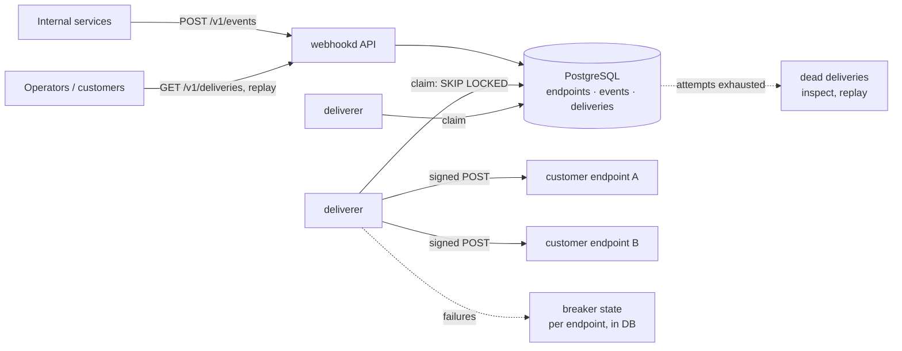
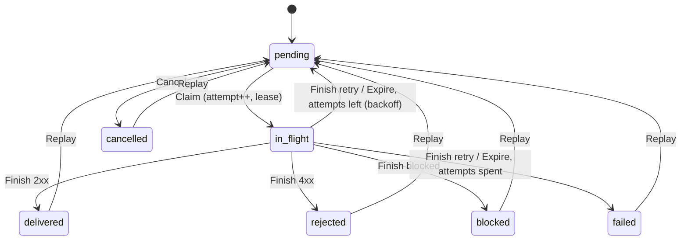

# go-webhook-gateway

[](https://github.com/Nguyenngoctruong274/go-webhook-gateway/actions/workflows/ci.yml)


[](LICENSE)

A webhook delivery gateway in Go. Internal services publish events once;
the gateway fans them out to every subscribed customer endpoint, signs
each request with HMAC, retries with backoff when the receiver fails,
stops hammering an endpoint that is down, refuses to call addresses it
should not, and keeps the delivery history so customers can see what
happened and replay it.

> 🚧 Built in public as a 10-day series. See the [roadmap](#roadmap) for progress.

## Why

Sending an HTTP POST is easy. Sending it reliably to a thousand customers'
servers, some of which are slow, broken, or hostile, is where the work is.
This project answers those questions with code and tests:

- **Authenticity.** Every request carries an HMAC-SHA256 signature over a
  timestamp and the body, so a receiver can reject forgeries and replays.
  Secrets rotate without a window where deliveries fail.
- **At-least-once, with a stable id.** A delivery may be retried; each
  carries an id the receiver can use to deduplicate.
- **Retries that respect the receiver.** 2xx is done, most 4xx are the
  receiver's final answer, 5xx and timeouts retry with exponential backoff
  and jitter, and after the last attempt the delivery is dead for an
  operator to replay.
- **Circuit breaker per endpoint.** An endpoint that keeps failing is
  skipped for a while rather than retried by every delivery at once; the
  state is shared by all gateway instances.
- **SSRF-safe.** Customer-supplied URLs cannot reach loopback, private or
  link-local addresses, including through DNS rebinding or redirects.
- **Visible.** Delivery history with response snippets, per-endpoint
  success rates and latency, Prometheus metrics and alerts.

## Architecture



The diagram is the target design; the [roadmap](#roadmap) shows what is
built so far.

| Package | Responsibility |
|---|---|
| `cmd/webhookd` | Service wiring, graceful shutdown |
| `cmd/webhook-receiver` | Reference receiver: verifies signatures, ignores duplicate deliveries, asks for retries on failure |
| `internal/config` | Environment configuration with validation |
| `internal/httpapi` | Probes now; endpoints, events and deliveries later |
| `internal/event` | Domain: events, endpoints, deliveries; outcome classification; delivery state machine with fenced attempts; retry backoff with jitter (no I/O) |
| `internal/signing` | HMAC-SHA256 signing headers, verification with constant-time compare and timestamp tolerance, secret rotation with overlap |
| `internal/postgres` | Connection pool, embedded migrations, store (day 4) |
| `internal/deliverer` | Workers that claim deliveries and POST them (day 5) |
| `internal/breaker` | Per-endpoint circuit breaker with shared state (day 6) |
| `internal/testdb` | Isolated PostgreSQL schema per test |

## Quick start

```bash
make up          # PostgreSQL in Docker (databases webhooks and webhooks_test)
make run         # webhookd on :8080
curl localhost:8080/healthz   # {"status":"ok"}
curl localhost:8080/readyz    # {"status":"ready"}; 503 if PostgreSQL is down
make test-db     # unit tests + tests against the real PostgreSQL
```

webhookd applies pending migrations at startup, under an advisory lock so
that several instances starting together migrate once.

Or run everything in containers: `make stack`.

## Configuration

| Variable | Default | Description |
|---|---|---|
| `WH_DATABASE_URL` | required | `postgres://` or `postgresql://` URL of the database |
| `WH_DB_MAX_CONNS` | `20` | Maximum open database connections (API and deliverers share them) |
| `WH_HTTP_ADDR` | `:8080` | Listen address |
| `WH_LOG_LEVEL` | `info` | `debug`, `info`, `warn`, `error` |
| `WH_SHUTDOWN_TIMEOUT` | `15s` | Maximum time to finish in-flight requests |
| `WH_SHUTDOWN_DRAIN` | `0` | Time `/readyz` reports 503 before the listener closes |

Invalid configuration is reported all at once at startup, without echoing
the database URL (it holds a password).

## Probes and shutdown

- `GET /healthz`: liveness. Does **not** touch PostgreSQL, so a database
  blip does not restart every pod.
- `GET /readyz`: readiness. Returns 503 while draining or while PostgreSQL
  does not answer a ping.
- On `SIGTERM`: readiness turns 503, the service waits `WH_SHUTDOWN_DRAIN`,
  then shuts the HTTP server down within `WH_SHUTDOWN_TIMEOUT`.

## Domain

`internal/event` holds the rules and no I/O; the store and the deliverer
apply them, and the tests here are the reference.

**Events and endpoints.** A producer publishes `Spec{Type, Payload,
IdempotencyKey}`: the type is `order.paid`-style, the payload a JSON
object or array up to 256 KiB. A customer registers `EndpointSpec{URL,
Types, MaxAttempts}`: absolute http(s), no credentials or fragment,
subscribed to listed types or to all. Whether the URL's host may be
contacted at all is decided at delivery time against the resolved
address (day 7), because DNS can change after registration.

**Outcome of an attempt.**

| Receiver's answer | Outcome | Then |
|---|---|---|
| 2xx | `Delivered` | done |
| 5xx, 408, 429, timeout, connection error | `Retry` | next attempt after the backoff; `failed` once attempts are spent |
| any other 4xx, 3xx (redirects are not followed) | `Rejected` | done: repeating the same request would get the same answer |
| gateway refused to send (forbidden address) | `Blocked` | done: the endpoint needs fixing |

**Delivery lifecycle.** One event × one subscribed endpoint = one
delivery, with the endpoint's `MaxAttempts` copied in at fan-out time.



The attempt number is a fencing token: `Claim` returns it, and `Finish`
and `Heartbeat` must present it. A deliverer that stalled past its lease
and reports after the reaper handed the delivery on is refused with
`ErrLeaseLost`; the attempt that replaced it is untouched. Every refused
transition leaves the delivery exactly as it was.

**Retry backoff.** `Backoff{Base, Max, JitterPercent}`: the ceiling
doubles per failed attempt from 5s, capped at 1h, and half of it is
random by default, so a receiver recovering from an outage is not hit by
every pending delivery at once. With the default 8 attempts the last
retry comes about 21 minutes after the first failure.

`FuzzDeliveryInvariants` drives a delivery through random sequences of
claim, finish (every outcome), stale-token finish, expire, cancel, replay
and heartbeat, with time moving, and checks that the attempt counter
stays within bounds, a lease exists exactly while in flight, a pending
delivery always has attempts left, a refused operation changes nothing,
and a stale token is never accepted. CI fuzzes for 20s on every push.

## Signing

Every delivery carries three headers:

```http
POST /webhook HTTP/1.1
Webhook-Id: 1042
Webhook-Timestamp: 1793786400
Webhook-Signature: v1=67c9e8d3…aefef7da[, v1=<signature under the previous secret>]
Content-Type: application/json

{"type":"order.paid","data":{"id":42}}
```

The signature is `hex(HMAC-SHA256(secret, "<timestamp>.<body>"))`. A
receiver in any language verifies it in four steps, which is what
`signing.Verifier` and the reference receiver do:

1. Read the raw body **before** parsing it; the signature is over the
   bytes on the wire.
2. Refuse timestamps more than 5 minutes from the receiver's clock. This
   runs before any HMAC, so the verifier is not a signing oracle for
   stale inputs, and it is what stops replays of captured requests:
   the timestamp is inside the MAC, so it cannot be moved.
3. Compute the HMAC for each secret the receiver holds and compare it in
   constant time with each `v1=` value in the header. Unknown schemes are
   skipped, so the gateway can add a `v2` later without breaking anyone.
4. Use `Webhook-Id` to ignore a delivery already processed: the gateway
   retries when a response is lost, so a receiver that is not idempotent
   will act twice.

```bash
# The same thing with openssl, to check an implementation:
printf '%s.%s' "$TS" "$BODY" | openssl dgst -sha256 -hmac "$SECRET"
```

**Secret rotation.** `Rotation.Rotate(next, now, overlap)` makes the new
secret current and keeps the old one active for `overlap`. During that
window the gateway signs every request with both, so a receiver that
still holds the old secret keeps verifying; after it, only the new one
signs. At most two secrets are ever active, so a receiver never needs to
accept more than two. Secrets are `whsec_` + 32 random bytes in hex, and
anything shorter than 16 bytes or with surrounding whitespace is refused
at both ends, the two mistakes that make signatures silently never match.

**Reference receiver.** `cmd/webhook-receiver` answers 401 for every
verification failure (one code for every cause, so a probe learns
nothing), 200 for a duplicate id, 500 when its handler fails so that the
gateway retries, and 200 on success. Its duplicate set is in memory and
swept past the tolerance window; a real receiver keeps it in its
database keyed by `Webhook-Id`.

```bash
RECEIVER_SECRETS=whsec_...,whsec_old... RECEIVER_ADDR=:9000 go run ./cmd/webhook-receiver
```

Tests sign and verify round trips, every rejection (tampered body, wrong
secret, missing or malformed headers, stale and future timestamps, a
fresh timestamp on an old signature, unknown schemes), both sides of a
rotation before and after the overlap, and `FuzzVerify` checks that the
verifier never accepts a signature it could not have produced. The
receiver is tested for accept-once, retry-after-failure and both-secrets
behaviour, and the binary was checked against a signature computed with
`openssl`.

## Roadmap

- [x] **Day 1**: Scaffold: config, probes, slog, graceful shutdown, Docker, compose with PostgreSQL, CI
- [x] **Day 2**: Domain: events, endpoints, deliveries; state machine; outcome classification (2xx, 4xx, 5xx, timeouts); backoff with jitter; fuzzing
- [x] **Day 3**: HMAC signing: `Webhook-Signature` / `-Timestamp` / `-Id` headers; secret rotation with an overlap window; reference receiver with replay protection
- [ ] **Day 4**: Schema and store: endpoints, events, deliveries; fan-out of one event to every enabled endpoint; idempotency keys; `SKIP LOCKED` claims
- [ ] **Day 5**: Deliverer: HTTP client with timeouts, body limits, no redirects; scheduled retries; dead-letter after the last attempt
- [ ] **Day 6**: Per-endpoint circuit breaker with state in PostgreSQL shared by all instances; half-open probes
- [ ] **Day 7**: SSRF protection (private, loopback and link-local ranges, pinned DNS); per-endpoint rate limit; optional in-order delivery per endpoint
- [ ] **Day 8**: Customer API: delivery history with response snippets, replay, pause and resume endpoints; end-to-end tests against the reference receiver
- [ ] **Day 9**: Metrics (success rate and latency per endpoint, backlog, breaker states), alerts, benchmarks
- [ ] **Day 10**: Final README, design decisions, Docker stack (webhookd, receiver, Prometheus), v1.0.0

## Notes

- Only `lib/pq` is used. The build environment of this project cannot
  fetch `golang.org/x`, `google.golang.org` or `gopkg.in`, so pgx, gRPC,
  the Prometheus client and YAML are out; the metrics exposition is
  written in the repository, as in the earlier projects of this series.

## License

[MIT](LICENSE)
