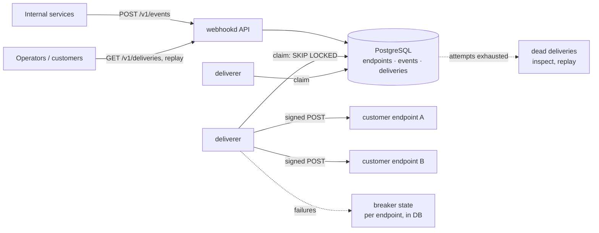

# go-webhook-gateway

[](https://github.com/Nguyenngoctruong274/go-webhook-gateway/actions/workflows/ci.yml)


[](LICENSE)

A webhook delivery gateway in Go. Internal services publish events once;
the gateway fans them out to every subscribed customer endpoint, signs
each request with HMAC, retries with backoff when the receiver fails,
stops hammering an endpoint that is down, refuses to call addresses it
should not, and keeps the delivery history so customers can see what
happened and replay it.

> 🚧 Built in public as a 10-day series. See the [roadmap](#roadmap) for progress.

## Why

Sending an HTTP POST is easy. Sending it reliably to a thousand customers'
servers, some of which are slow, broken, or hostile, is where the work is.
This project answers those questions with code and tests:

- **Authenticity.** Every request carries an HMAC-SHA256 signature over a
  timestamp and the body, so a receiver can reject forgeries and replays.
  Secrets rotate without a window where deliveries fail.
- **At-least-once, with a stable id.** A delivery may be retried; each
  carries an id the receiver can use to deduplicate.
- **Retries that respect the receiver.** 2xx is done, most 4xx are the
  receiver's final answer, 5xx and timeouts retry with exponential backoff
  and jitter, and after the last attempt the delivery is dead for an
  operator to replay.
- **Circuit breaker per endpoint.** An endpoint that keeps failing is
  skipped for a while rather than retried by every delivery at once; the
  state is shared by all gateway instances.
- **SSRF-safe.** Customer-supplied URLs cannot reach loopback, private or
  link-local addresses, including through DNS rebinding or redirects.
- **Visible.** Delivery history with response snippets, per-endpoint
  success rates and latency, Prometheus metrics and alerts.

## Architecture



The diagram is the target design; the [roadmap](#roadmap) shows what is
built so far.

| Package | Responsibility |
|---|---|
| `cmd/webhookd` | Service wiring, graceful shutdown |
| `cmd/webhook-receiver` | Reference receiver: verifies signatures, rejects replays (day 3) |
| `internal/config` | Environment configuration with validation |
| `internal/httpapi` | Probes now; endpoints, events and deliveries later |
| `internal/event` | Domain: events, endpoints, deliveries, state machine, retry policy (no I/O) (day 2) |
| `internal/signing` | HMAC signatures and secret rotation (day 3) |
| `internal/postgres` | Connection pool, embedded migrations, store (day 4) |
| `internal/deliverer` | Workers that claim deliveries and POST them (day 5) |
| `internal/breaker` | Per-endpoint circuit breaker with shared state (day 6) |
| `internal/testdb` | Isolated PostgreSQL schema per test |

## Quick start

```bash
make up          # PostgreSQL in Docker (databases webhooks and webhooks_test)
make run         # webhookd on :8080
curl localhost:8080/healthz   # {"status":"ok"}
curl localhost:8080/readyz    # {"status":"ready"}; 503 if PostgreSQL is down
make test-db     # unit tests + tests against the real PostgreSQL
```

webhookd applies pending migrations at startup, under an advisory lock so
that several instances starting together migrate once.

Or run everything in containers: `make stack`.

## Configuration

| Variable | Default | Description |
|---|---|---|
| `WH_DATABASE_URL` | required | `postgres://` or `postgresql://` URL of the database |
| `WH_DB_MAX_CONNS` | `20` | Maximum open database connections (API and deliverers share them) |
| `WH_HTTP_ADDR` | `:8080` | Listen address |
| `WH_LOG_LEVEL` | `info` | `debug`, `info`, `warn`, `error` |
| `WH_SHUTDOWN_TIMEOUT` | `15s` | Maximum time to finish in-flight requests |
| `WH_SHUTDOWN_DRAIN` | `0` | Time `/readyz` reports 503 before the listener closes |

Invalid configuration is reported all at once at startup, without echoing
the database URL (it holds a password).

## Probes and shutdown

- `GET /healthz`: liveness. Does **not** touch PostgreSQL, so a database
  blip does not restart every pod.
- `GET /readyz`: readiness. Returns 503 while draining or while PostgreSQL
  does not answer a ping.
- On `SIGTERM`: readiness turns 503, the service waits `WH_SHUTDOWN_DRAIN`,
  then shuts the HTTP server down within `WH_SHUTDOWN_TIMEOUT`.

## Roadmap

- [x] **Day 1**: Scaffold: config, probes, slog, graceful shutdown, Docker, compose with PostgreSQL, CI
- [ ] **Day 2**: Domain: events, endpoints, deliveries; state machine; outcome classification (2xx, 4xx, 5xx, timeouts); backoff with jitter; fuzzing
- [ ] **Day 3**: HMAC signing: `Webhook-Signature` / `-Timestamp` / `-Id` headers; secret rotation with an overlap window; reference receiver with replay protection
- [ ] **Day 4**: Schema and store: endpoints, events, deliveries; fan-out of one event to every enabled endpoint; idempotency keys; `SKIP LOCKED` claims
- [ ] **Day 5**: Deliverer: HTTP client with timeouts, body limits, no redirects; scheduled retries; dead-letter after the last attempt
- [ ] **Day 6**: Per-endpoint circuit breaker with state in PostgreSQL shared by all instances; half-open probes
- [ ] **Day 7**: SSRF protection (private, loopback and link-local ranges, pinned DNS); per-endpoint rate limit; optional in-order delivery per endpoint
- [ ] **Day 8**: Customer API: delivery history with response snippets, replay, pause and resume endpoints; end-to-end tests against the reference receiver
- [ ] **Day 9**: Metrics (success rate and latency per endpoint, backlog, breaker states), alerts, benchmarks
- [ ] **Day 10**: Final README, design decisions, Docker stack (webhookd, receiver, Prometheus), v1.0.0

## Notes

- Only `lib/pq` is used. The build environment of this project cannot
  fetch `golang.org/x`, `google.golang.org` or `gopkg.in`, so pgx, gRPC,
  the Prometheus client and YAML are out; the metrics exposition is
  written in the repository, as in the earlier projects of this series.

## License

[MIT](LICENSE)
